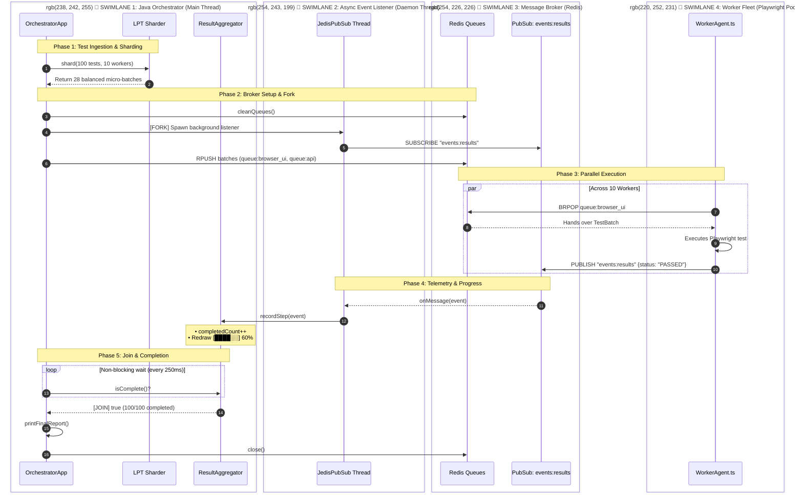
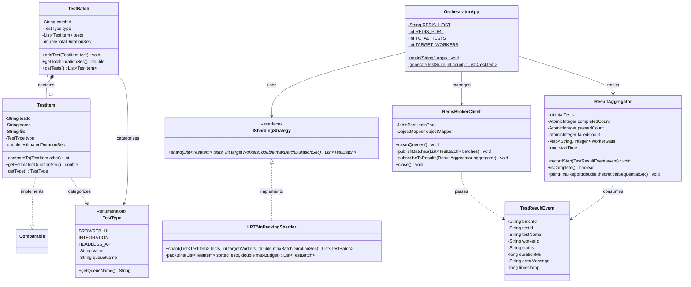

# Distributed Test Orchestrator - UML Architectural & Behavioral Models

This document presents the complete **UML (Unified Modeling Language)** specifications for the Distributed Test Orchestration Engine, featuring **Vertical Swimlanes with Box Pillars**, **Sequence Lifelines**, and **Class Models**.

---

## 1. Visual Swimlane Grid (Text Overview)

```text
==========================================================================================================================================
   SWIMLANE 1: ORCHESTRATOR (Java)     │  SWIMLANE 2: LISTENER (Java)   │  SWIMLANE 3: BROKER (Redis)   │  SWIMLANE 4: WORKER (Playwright)
==========================================================================================================================================
 1. main() generates 100 tests         │                                │                               │
 2. LPT Bin-Packing (25-30 packets)    │                                │                               │
 3. broker.cleanQueues() ──────────────┼────────────────────────────────┼──► DEL old queues             │
                                       │                                │                               │
 4. [FORK] Spawns daemon thread ───────┼──► 5. SUBSCRIBE events:results ┼──► Registers PubSub channel   │
 6. Dispatches packets ────────────────┼────────────────────────────────┼──► RPUSH queue:browser_ui...  │
                                       │                                │                               │
 7. Enters non-blocking loop:          │                                │                               │ 8. BRPOP queue:browser_ui
    while (!aggregator.isComplete())   │                                │                               │ 9. Runs Playwright Chromium
                                       │                                │                               │10. PUBLISH events:results
                                       │                                │                               │    {status: PASSED, 120ms}
                                       │                                │                               │              │
                                       │ 11. onMessage(event) ◄─────────┼───────────────────────────────┼──────────────┘
                                       │ 12. completedCount.inc()       │                               │
                                       │ 13. Redraws live progress bar  │                               │
                                       │                                │                               │
 14. [JOIN] isComplete() == true ◄─────┼─── (All 100 tests verified)    │                               │
 15. Prints final duration & report    │                                │                               │
 16. Closes JedisPool & Exits          │                                │                               │
==========================================================================================================================================
```

---

## 2. UML Vertical Swimlane Diagram (Color Box Pillars)

Open this document in **Markdown Preview (`Cmd + Shift + V`)** to view the distinct vertical swimlane pillars:



---

## 3. UML Class Diagram (Structural Object Model)


